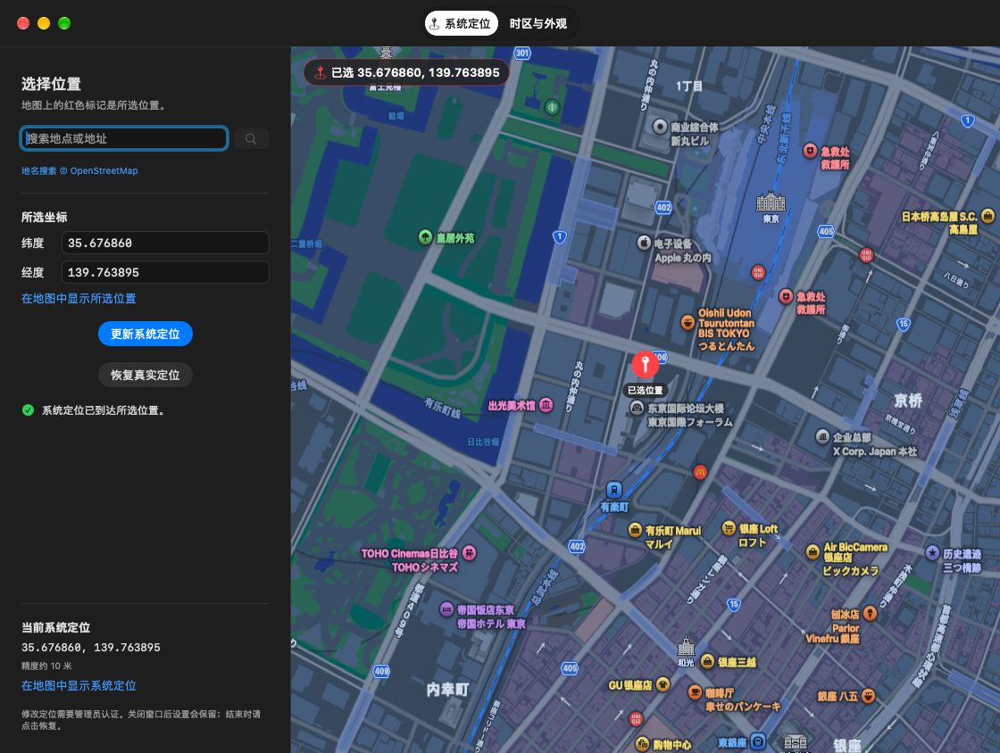
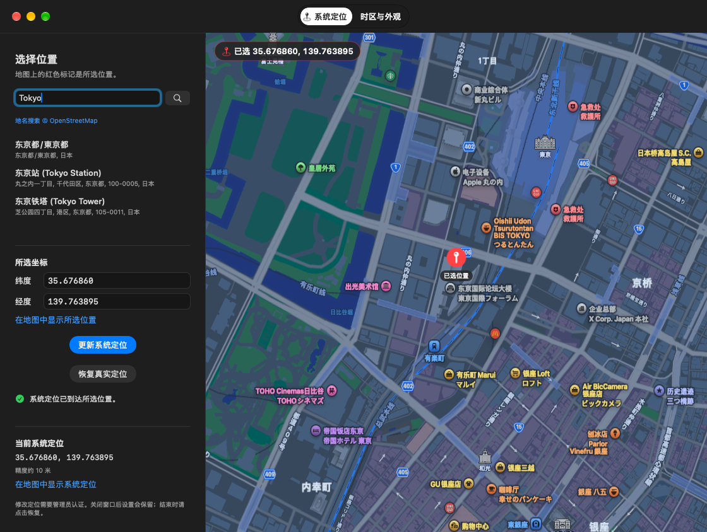
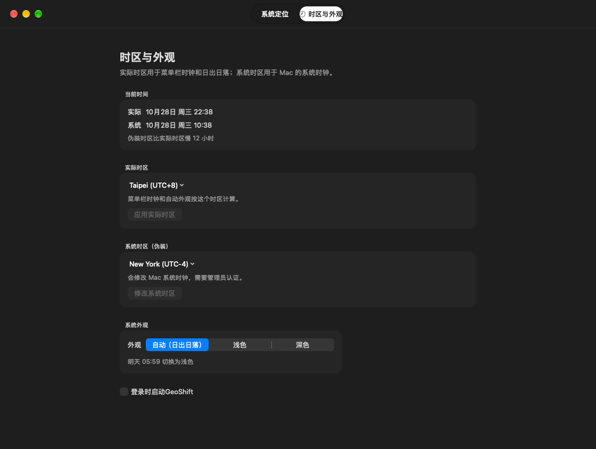

# GeoShift

菜单栏和窗口工具，支持设置 Mac 的系统定位、调整时区、控制深浅色。关闭窗口后仍留在菜单栏。

默认实际时区是台北。两个时区都可以在菜单里改，不写死东八区或纽约。

## 功能概览

| 模块 | 主要能力 | 权限与边界 |
| --- | --- | --- |
| **系统定位** | 地图单击/长按选点、地名搜索（OpenStreetMap Nominatim）、直接输入经纬度（纬度 `-90~90`，经度 `-180~180`）、Core Location 距离核验（≤ 25 米）、一键恢复原定位配置 | 设置/恢复需管理员认证；读取当前系统定位需允许「定位服务」权限；修改定位不会自动调整时区 |
| **双时区时钟** | **伪装时区**修改 Mac 系统时区（按洲分组，含夏令时自动偏移）；**实际时区**用于菜单栏时钟显示与日出日落计算 | 修改伪装时区需确认并输入管理员密码；修改实际时区仅需确认，不改系统时区 |
| **深浅色外观** | 按实际时区城市坐标（取自系统 `zone.tab`）的日出日落自动切换浅色/深色，或手动固定浅色/深色 | 需在「系统设置 → 隐私与安全性 → 自动化」中允许控制「系统事件」 |
| **常驻与启动** | 菜单栏实时显示实际时区日期、星期、时间与当前外观图标（按整分定时更新，其余时间不轮询）；支持登录时启动 | 关闭主窗口后仍留在菜单栏；可通过 `⌘O` 或点击 Dock/菜单栏重新打开主窗口 |

## 界面截图

### 系统定位与坐标核验



### 全球地名搜索



### 时区与外观设置



## 系统定位

菜单栏 →「系统定位」可以输入坐标、应用窗口中选好的位置、恢复原定位。点击「打开主窗口」后，可以搜索地名、在地图单击或长按选点，或直接输入经纬度。选点后会显示红色图钉、已选坐标徽标和待应用提示。

选择位置后点击「设置系统定位」。需要管理员认证；窗口里的「当前系统定位」来自 Core Location，收到新读数且距离目标不超过 25 米后才显示核验成功。修改定位不会自动调整时区。

第一次设置会保存原有模拟配置的状态，后续更新保留这份备份。「恢复真实定位」恢复原配置。关闭窗口或退出程序会保留已设置的位置。合并版与此前的「Mac 定位」使用同一份恢复记录，可以恢复此前设置的定位。

当前版本在这台 Mac 的 macOS 27.0 上验证。它修改 locationd 的模拟配置并重启定位服务，影响使用系统 Core Location 的应用；不能保证每个应用都立即刷新缓存或使用同一种定位来源。恢复记录位于 `/var/db/mac-location-control`，仅管理员可访问。请保留这份记录，直到成功恢复。

地名搜索使用 OpenStreetMap Nominatim，地图显示使用 MapKit。搜索词会发送到搜索服务，当前系统坐标不会附带发送。请勿搜索私人或保密信息。按 [Nominatim 使用规则](https://operations.osmfoundation.org/policies/nominatim/)，本程序只在点击搜索或按回车时请求，每秒最多一次，同一次运行内缓存相同查询，不做自动补全或批量查询。结果署名和许可见 [OpenStreetMap](https://www.openstreetmap.org/copyright)。这是个人使用构建；公开分发前需重新评估搜索服务容量。

搜索服务可切换到符合 Nominatim API 的 HTTPS 服务，无需重建：

```bash
defaults write local.dongba.appearance geocodingEndpoint 'https://你的服务/search'
```

退出并重新打开程序后生效。

## 两个时区

**伪装时区**会改 Mac 的系统时区。系统时钟、菜单栏右上角的时间都会变成那个城市的当地时间。点选后要先确认，再输入管理员密码。

**实际时区**不改系统时区。菜单栏里这个程序显示的时间，以及浅色、深色切换，都按它计算。点选后只需确认，不用管理员密码。

时区按洲展开，不把全部城市铺在第一层。偏移来自系统时区数据库，所以纽约在夏令时是 UTC-4，冬令时会变成 UTC-5。

自动深浅色按实际时区的日出和日落切换。城市坐标来自系统的 `zone.tab`，不是固定的 7:00 和 19:00。例如系统时区停在纽约的中午，而实际时区是台北的半夜，菜单栏显示台北时间，外观是深色。也可在菜单栏「外观」或窗口「时区与外观」中固定浅色或深色。

时钟每到实际时区的下一分钟更新一次，其余时间不轮询。

## 安装

可直接从 [GitHub Releases](https://github.com/a1024053774/GeoShift/releases) 下载预编译包（Apple Silicon），或从源码构建。当前个人构建需要 macOS 27 和 Command Line Tools。旧版 1.0 的 macOS 13 支持不适用于此合并版。

```bash
make
open build/GeoShift.app --args --show-window
```

把 `build/GeoShift.app` 放到「应用程序」。允许本程序控制「系统事件」以切换外观，并在「系统设置 → 隐私与安全 → 定位服务」允许「GeoShift」读取位置以核验结果。设置系统定位、修改系统时区需要管理员认证。

定位授权桥使用已弃用的 `AuthorizationExecuteWithPrivileges`，用于这台 Mac 的本地构建。正式发行前应改用签名的 `SMAppService` 特权辅助程序。

`make run` 会编译并打开。`make test` 跑时区、夏令时和日出日落的检查。`make clean` 删掉 `build/`。

## 许可

[MIT](LICENSE)
